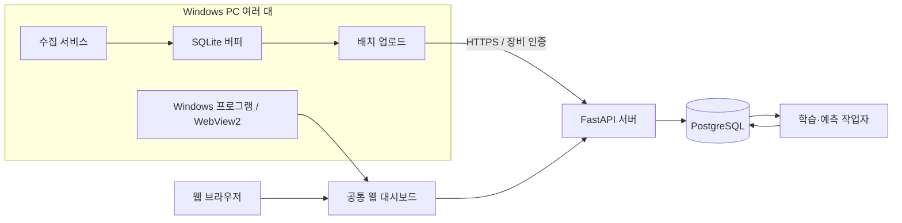

# PC Telemetry & Forecast

- [S1-07 개발 환경·CI 안내](infra/README.md)
- [실제 PC 2대 센서 지원 검증 표 (관측 대기)](docs/sensor-support.md)

- [S1-03 수집 API·PostgreSQL 실행 및 설계](backend/README.md)
- [S1-03 로컬 통합 검증 결과](tests/results/s1-03-backend.json)
- [S1-09 부하 전환 수집 계획·라벨 규격](docs/s1-09-load-transition-plan.md)
- [S1-04 공통 대시보드 개발 안내](dashboard/README.md)
- [S2-05 과거 조회 화면·API 연결 계약](docs/s2-05-history-read-contract.md)
- [S2-06 React/TS 공통 조회 스케줄러·WebView 메시지 계약](docs/s2-06-query-scheduler.md)

- [S1-01 수집·시각 API 계약 초안](contracts/README.md) — 공동 검토 대기
- [S1-01 계약 검증 안내](tests/README.md)

- [GitHub 저장소](https://github.com/SongWooSeok02/pc-telemetry-forecast)
- [개발 Project 및 43개 작업](https://github.com/users/SongWooSeok02/projects/1)
- 로컬 작업 경로: `C:\DEV\pc-telemetry-forecast`

여러 Windows PC의 CPU·GPU 온도와 소비전력을 수집하고, 중앙 서버에서 분석·예측하는 모니터링 프로그램의 개발 계획서입니다.

> 본 문서는 구현 계획입니다. 아래 기능이 이미 구현되었거나 성능이 검증되었다는 의미는 아닙니다.

## 1. 프로젝트 개요

| 항목 | 계획 |
|---|---|
| 개발 기간 | 5주, 주 단위 스프린트 5회 |
| 개발 인원 | 3명 |
| 기본 플랫폼 | Windows 11 x64 우선 |
| 이용 방식 | 웹 브라우저 및 Windows 프로그램 내부 대시보드 |
| 수집 대상 | CPU·GPU 온도, 지원되는 소비전력, 사용률, 클럭, 팬 속도 |
| 제외 대상 | PSU, 팬·전력 자동 제어, 고장 시점 예측, 타 OS |
| 초기 규모 | 등록 PC 10대 목표, 실제 PC 3대 이상 검증 |
| 최종 결과물 | Windows 설치 파일, 웹 대시보드, 서버 배포 구성, 예측 모델, 문서 |

### 핵심 목표

- 여러 PC를 등록하고 장비별 현재 상태와 과거 데이터를 조회합니다.
- 네트워크나 서버가 중단되어도 로컬에 데이터를 보관하고 복구 후 전송합니다.
- 웹과 Windows 프로그램에서 동일한 대시보드를 제공합니다.
- 사용자가 대시보드 이용 중 갱신 주기를 언제든 변경하고 즉시 적용합니다.
- CPU·GPU의 60초 후 온도를 예측하고 실제값과 비교합니다.
- 전력 예측은 기준 모델 대비 개선 여부를 평가한 후 제공 여부를 결정합니다.

## 2. 기능 범위

| 영역 | 출시 필수 기능 |
|---|---|
| 에이전트 | 센서 탐색, 주기 수집, 로컬 버퍼, 배치 업로드, 재시도 |
| PC 관리 | 등록 코드, 장비 인증, 이름 설정, 온라인 상태, 인증 회수 |
| 대시보드 | PC 목록, 현재 수치, 과거 차트, 예측 비교, 수집 상태 |
| 갱신 설정 | 상시 접근 가능한 제어 UI, 실행 중 변경, 즉시 반영, 수동 모드 |
| 모델 | 기준 모델, 온도 모델 학습·평가, 모델 버전, 예측 저장 |
| 배포 | 설치·삭제, 서비스 자동 시작, 수동 업데이트, 서버 실행 문서 |
| 운영 | 로그, 보존 정책, 백업·복구, 지원 센서 및 제한 안내 |

전력·팬 센서가 없는 PC에서도 나머지 기능은 동작해야 합니다. 미지원 센서는 0으로 처리하지 않고 `미지원`으로 표시합니다. 센서 온도는 발열 상태를 판단하는 지표이며 발생 열량 자체와 동일하지 않습니다.

## 3. 시스템 구조



### 기술 구성

| 구성 | 제안 기술 | 책임 |
|---|---|---|
| Windows 수집 서비스 | C# / .NET, LibreHardwareMonitorLib | 센서 접근, 수집, 전송 |
| Windows 프로그램 | .NET 데스크톱 셸, WebView2 | 대시보드 표시, 등록 및 서비스 상태 |
| 로컬 버퍼 | SQLite | 미전송 데이터 보관 |
| API | Python / FastAPI | 인증, 수집, 조회 |
| DB | PostgreSQL | 장비, 센서, 측정, 모델, 예측 관리 |
| 웹 UI | React / TypeScript | 공통 대시보드 |
| 분석 | pandas / scikit-learn | 특징 생성, 모델 학습·평가 |
| 서버 실행 | Docker Compose | API·DB·작업자 구성 |
| 자동 검사 | GitHub Actions | 빌드, 테스트, 정적 검사 |

센서 수집 서비스는 Windows 호스트에서 실행합니다. 프로그램 창을 닫아도 서비스는 수집을 계속합니다. 초기 버전의 Windows 대시보드는 서버 연결이 필요하며, 오프라인에서는 연결 상태와 로컬 대기 데이터 수를 표시합니다.

## 4. 대시보드 실시간 갱신 설정

### 4.1 UI 요구사항

**최초 실행용 갱신 설정 팝업은 띄우지 않습니다.** 대시보드를 기본 5초 주기로 표시하고, 상단에 항상 보이는 갱신 제어를 제공합니다.

```text
PC: 개발-PC-01   [갱신: 5초 ▼] [지금 갱신]
마지막 수신: 14:32:10   데이터 지연: 2초   연결됨

갱신 메뉴
  3초
✓ 5초
  10초
  30초
  수동
```

- 사용자가 화면을 보고 있는 동안 언제든 주기를 변경합니다.
- 선택 즉시 적용하며 별도 저장 버튼이나 재시작을 요구하지 않습니다.
- 선택한 값을 현재 브라우저·앱의 로컬 설정에 자동 저장합니다.
- 재접속 시 저장값을 사용하고, 값이 없거나 유효하지 않으면 5초를 사용합니다.
- 웹과 Windows 프로그램은 같은 동작을 제공하되 설정은 각 클라이언트에 독립 저장합니다.
- 설정을 바꿔도 선택 PC, 조회 기간, 차트 확대 구간, 스크롤 위치를 유지합니다.
- 데이터만 다시 조회하고 페이지 전체를 새로고침하지 않습니다.

### 4.2 갱신 로직

1. 자동 모드에서 주기를 변경하면 기존 예약을 제거합니다.
2. 진행 중인 요청이 없으면 즉시 한 번 조회하고 새 주기로 예약합니다.
3. 요청이 진행 중이면 요청을 중복 실행하지 않고 완료 후 새 설정으로 예약합니다.
4. 수동 모드로 변경하면 이후 자동 예약을 중단합니다. 이미 진행 중인 응답은 반영할 수 있습니다.
5. `지금 갱신`은 즉시 조회를 요청하되, 진행 중인 요청과 중복 실행하지 않습니다.
6. 요청 소요 시간이 설정 주기보다 길면 밀린 요청을 쌓거나 연속 실행하지 않습니다.
7. PC나 조회 조건 변경으로 오래된 요청이 남으면 취소하거나 응답 버전을 확인해 무시합니다.
8. 숨겨진 탭·최소화된 앱에서는 자동 조회를 중지합니다. 자동 모드로 복귀하면 즉시 조회하고 예약을 재개합니다.
9. 자동 모드에서 조회 실패 시 기존 데이터를 유지하며 오류와 데이터 경과 시간을 표시합니다. 재시도 간격은 점진 증가시키되 선택 주기보다 짧지 않게 하고 최대 60초로 제한합니다. 성공하면 선택 주기로 복귀합니다. 수동 모드에서는 실패해도 자동 재시도하지 않습니다. 재시도 대기 중 수동으로 전환하면 예약을 취소합니다.
10. 화면 종료 시 타이머와 요청을 정리합니다.

예약 기준은 단조 시간 기준으로 관리하고, 이전 요청 시작 이후 선택 간격이 지났는지 확인합니다. 지연된 주기는 건너뛰며 정상적인 상황에서 선택한 간격으로 요청을 시작하도록 구현합니다.

### 4.3 수집·전송·화면 조회·예측의 분리

| 처리 | 초기 설정 | 변경 주체 |
|---|---|---|
| 센서 수집 | 1초 | 에이전트 설정 |
| 서버 전송 | 3초 배치 | 에이전트 설정 |
| 화면 조회 | 기본 5초, 3·5·10·30초 또는 수동 | 사용자, 실행 중 변경 |
| 예측 생성 | 10초마다 | 서버 설정 |
| 예측 대상 | 60초 후 온도 | 모델 설정 |

화면 주기를 변경해도 센서 수집·서버 전송·모델 실행 주기는 바뀌지 않습니다. 최소 조회 간격은 전송 간격과 같은 3초로 제한합니다. 네트워크 지연으로 같은 데이터가 보일 수 있으므로 마지막 관측 시각과 지연을 표시합니다. 화면 조회마다 모델을 다시 실행하지 않습니다.

### 4.4 화면 구성

| 화면 | 내용 |
|---|---|
| PC 목록 | 이름, 연결 상태, CPU·GPU 온도, 마지막 수신 시각 |
| PC 상세 | 현재 온도·전력·부하·클럭·팬, 시간별 차트 |
| 예측 | 실제값·예측값, 예측 생성 시각, 대상 시각, 모델 상태 |
| 수집 상태 | 미지원 센서, 오류, 결측, 에이전트 버전 |
| 설정 | PC 표시 이름, 등록·연결 정보 |

PC 목록은 요약 데이터를 조회하고 상세 화면은 선택 PC만 조회합니다. 과거 차트는 전체 기간을 매번 내려받지 않고 집계·증분 조회를 사용합니다.

## 5. 수집 및 데이터 설계

### 수집 원칙

- CPU 패키지 전력, GPU 보드 전력 등 측정 범위를 구분합니다.
- CPU·GPU 전력 합계를 PC 전체 소비전력으로 표기하지 않습니다.
- 중복되는 전력 센서를 합산하지 않습니다.
- 에너지 사용량은 유효한 전력 관측 구간을 적분해 계산하고 결측 구간과 측정 범위를 표시합니다.
- 관측 시각과 서버 수신 시각을 UTC로 저장하고 화면에서 현지 시간으로 표시합니다.
- 재부팅·절전·재개·센서 변경을 이벤트로 기록합니다.
- 센서 보고값과 모델 예측값을 구분합니다.

### 주요 테이블

| 테이블 | 내용 |
|---|---|
| users / machines | 사용자와 등록 PC, 소유 관계 |
| device_credentials | 장비 인증 정보, 만료·회수 상태 |
| components / sensors | 부품, 센서, 단위, 출처, 측정 범위 |
| measurements | 관측 시각, 수신 시각, 값, 품질 상태 |
| collection_events | 오류, 절전·재개, 구성 변경 |
| training_runs / models | 데이터 기간, 평가, 모델 버전·파일 위치 |
| predictions | 생성 시각, 대상 시각, 예측값, 모델 버전 |

장비·부팅 세션·샘플 순번으로 샘플을 식별하고, 배치 ID로 재전송을 추적합니다. 중복 방지는 DB 제약과 서버 처리로 보장합니다.

### 규모 및 보존 정책

PC 10대 × 센서 12개 × 1초 수집을 센서별 행으로 저장하면 하루 10,368,000행입니다. 배치 전송은 통신 횟수를 줄일 뿐 데이터량을 줄이지 않습니다.

| 데이터 | 초기 보존 기간 |
|---|---|
| 원시 1초 데이터 | 7일 |
| 10초 집계 | 30일 |
| 1분 집계 | 90일 |
| 학습 데이터 | 선정한 기간 별도 보관 |
| 로컬 미전송 버퍼 | 초기 24시간 또는 500MB 중 먼저 도달하는 상한 |

보존 기간은 설정 가능하게 하고 실제 용량 측정 후 확정합니다. 집계에는 평균·최대·유효 샘플 수를 포함합니다. 10초·1분 집계의 구간은 관측 시각 기준 UTC로 정렬합니다. 지연 도착 데이터가 커밋되면 같은 트랜잭션에서 해당 장비·센서·관측 구간을 재집계 대상으로 등록하고, 작업자가 원시 데이터 전체로 두 집계를 다시 계산해 upsert합니다. 이전 집계에 가산하지 않아 재시도 시 중복 집계를 방지합니다. 작업 중 추가 도착은 변경 버전으로 감지해 다시 처리하며 실패 작업은 유지·재시도합니다. 버퍼의 최대 24시간 지연을 포함한 최근 24시간 구간은 미확정으로 취급하고, 그보다 오래된 관측 구간도 데이터가 수락되면 동일하게 재집계합니다. 집계 갱신 시각·대기 상태를 조회에 제공하며, 마지막 수신 후 재집계 성공 전에는 원시 파티션을 삭제하지 않습니다. S3-03에서 구현하고 지연 전송·재전송·구간 경계 사례를 검증합니다. 버퍼 상한 도달 시 오래된 미전송 데이터를 제거하고 누락 범위를 로그와 상태에 남깁니다.

## 6. 예측 모델 계획

| 대상 | 입력 | 출력 | 우선순위 |
|---|---|---|---|
| CPU 온도 | 최근 5분의 온도·전력·부하·클럭 | 60초 후 온도 | 필수 |
| GPU 온도 | 최근 5분의 온도·전력·부하·팬 | 60초 후 온도 | 필수 |
| CPU·GPU 전력 | 최근 5분의 전력·부하·클럭 | 향후 60초 평균 전력 | 성능 확인 후 제공 |

### 개발 순서

1. 현재값 유지와 이동 평균 기준 모델을 구현합니다.
2. 과거 값, 구간 평균·최대, 변화율 등 특징을 생성합니다.
3. 회귀 모델을 학습하고 기준 모델과 비교합니다.
4. PC별 모델을 우선 적용하고 데이터 부족 시 기준 모델을 사용합니다.
5. 모델 버전과 평가 결과를 저장하고 활성 모델을 선택합니다.

### 평가 규칙

- 시간순 학습·검증·테스트 분할을 사용하고 예측 구간이 경계를 침범하지 않게 합니다.
- 전처리 기준은 학습 데이터에서만 계산합니다.
- 절전·재부팅 등의 긴 공백을 보간으로 연결하지 않습니다.
- 온도 MAE(°C), 전력 MAE(W), 기준 모델 대비 개선율을 기록합니다.
- 유휴·고부하·부하 전환별 오차와 센서 결측률을 확인합니다.
- 기준 모델보다 개선되지 않는 모델은 활성화하지 않습니다.
- 미래 작업 부하를 알 수 없는 단기 예측의 한계를 문서에 명시합니다.

## 7. 등록·인증·배포

### 등록 흐름

1. 사용자가 웹에 로그인합니다.
2. 유효기간이 있는 일회용 등록 코드를 발급합니다.
3. Windows 프로그램에서 코드를 입력합니다.
4. 서버가 장비 식별자와 장비 전용 인증 정보를 발급합니다.
5. 에이전트가 HTTPS로 전송하며 서버는 인증된 장비 기준으로 데이터를 저장합니다.

사용자 인증과 장비 인증을 분리하고, 사용자별 PC 접근 제어와 장비 인증 회수를 제공합니다. WebView2 로그인 세션을 수집 서비스와 분리하며, 프로그램에 비밀번호나 장기 토큰을 URL로 전달하지 않습니다.

### Windows 배포

- 설치·삭제, 서비스 등록·자동 시작을 지원합니다.
- WebView2 런타임 존재 여부와 설치 경로를 확인합니다.
- 업데이트 시 설정과 미전송 데이터를 유지합니다.
- 초기 버전은 버전 확인 후 설치 파일을 실행하는 수동 업데이트 방식입니다.
- 무료 프로그램 배포를 기준으로 배포 경로와 코드 서명 필요성을 재검토합니다. 유료 서명 구매·신청·발급은 출시 필수 조건에서 제외하며 실제 다운로드·설치·실행을 검증합니다. [배포·서명 재검토 기록](docs/signing-status.md)을 따릅니다.
- 센서 접근 권한과 서비스 계정 요구사항을 실제 장비에서 검증합니다.
- 설치 파일 버전·체크섬·지원 환경을 공개합니다.

## 8. 역할 분담

| 담당 | 책임 |
|---|---|
| A | Windows 수집·서비스·SQLite·재전송·WebView2·설치·업데이트 |
| B | API·DB·인증·PC 등록/목록·접근 제어·배포·운영 |
| C | 공통 대시보드·실시간 갱신 제어·차트·분석·모델 평가 |

B가 PC 목록·등록 화면을 맡고 A가 Windows 셸을 맡아 C의 UI·모델 업무 집중을 줄입니다. 첫 이틀에 공통 계약을 확정하고 1주 차부터 통합합니다.

## 9. GitHub Projects 운영

프로젝트 이름: **PC Telemetry — v0.1.0**

| 필드 | 값 |
|---|---|
| Status | Backlog / Ready / In Progress / In Review / Done |
| Sprint | Sprint 1~5, 각 1주 |
| Area | Agent / Backend / Dashboard / ML / Release |
| Priority | P0 출시 필수 / P1 핵심 개선 / P2 여유 시 |
| Assignee | 주 담당자 1명 |
| Estimate | 예상 작업일 |
| Blocked by | 선행 이슈 또는 차단 사유 |

### 보드 및 관리 규칙

- 현재 스프린트: 상태별 칸반.
- 5주 로드맵: 스프린트별 일정.
- 담당자별 작업: 업무량과 병목 확인.
- 출시 필수: 미완료 P0와 차단 이슈.
- 라벨: `area:agent`, `area:backend`, `area:dashboard`, `area:ml`, `area:release`, `bug`, `blocked`.
- 마일스톤: `v0.1.0`.
- 기능은 1~2일 안에 리뷰 가능한 이슈로 분할합니다.
- 일일 진행 공유, 주초 스프린트 계획, 주말 통합 시연·회고를 진행합니다.
- PR은 다른 팀원 1명이 검토하고 필요한 자동 검사가 통과해야 병합합니다.
- 담당자당 진행 중 구현 이슈는 원칙적으로 1개로 제한합니다.
- 차단 상태는 사유·해결 담당·선행 이슈를 기록합니다.

## 10. 5주 스프린트 계획

### Sprint 1 — 수집부터 웹·앱 화면까지 연결

목표: PC 2대의 실제 데이터가 서버에 저장되고 웹과 Windows 프로그램에 표시됩니다.

| ID | 이슈 | 담당 | 우선순위 |
|---|---|---|---|
| S1-01 | 데이터 규격·센서 단위·불변 배치·시각 오프셋 측정 API 계약 확정 | B, 공동 검토 | P0 |
| S1-02a | 첫 이틀 드라이버·권한·Defender·서비스 설치 스파이크 | A | P0 |
| S1-02b | 스파이크 통과 후 CPU·GPU 센서 탐색 및 1초 수집 | A | P0 |
| S1-03 | 수집 API·일별 파티션·중복 방지 설계·가상 데이터 | B | P0 |
| S1-04 | 공통 대시보드 골격·현재값 표시 | C | P0 |
| S1-05 | 상단 갱신 제어·즉시 적용·설정 유지 | C | P0 |
| S1-06 | Windows 셸·WebView2·초기 설치 검증 | A | P0 |
| S1-07 | CI·개발 환경·센서 지원 표 | B | P0 |
| S1-08 | 무료 배포 방식·코드 서명 필요성 재검토 | B | P0 |
| S1-09 | 부하 전환 시나리오·라벨 규격·수집 시작 | C | P0 |

완료 조건: 최초 설정 팝업 없이 화면을 열고 실행 중 갱신 주기를 변경할 수 있습니다. 실제 PC 2대의 센서 지원 여부를 기록합니다.

### Sprint 2 — 지속 수집과 다중 PC 관리

목표: PC 재부팅과 서버 중단 후 수집·전송이 복구됩니다.

| ID | 이슈 | 담당 | 우선순위 |
|---|---|---|---|
| S2-01 | SQLite 버퍼·상한·재전송 | A | P0 |
| S2-02 | Windows 서비스 자동 시작 | A | P0 |
| S2-03 | 등록 코드·장비 인증·회수 | B | P0 |
| S2-04 | 중복 방지·PC 목록·온라인 상태 | B | P0 |
| S2-05 | 과거 차트·수신 시각·미지원 표시 | C | P0 |
| S2-06 | React/TS 공통 조회 스케줄러·경합·수동 모드·호스트 상태 연동 | C | P0 |
| S2-07a | 결측·시계 오차·센서 품질 집계 | B | P0 |
| S2-07b | 기준 모델 및 평가 파이프라인 | C | P0 |
| S2-08 | 무료 배포 경로·미서명 시험 배포 검증 | B | P0 |

완료 조건: 서버 30분 중단 후 데이터가 중복 없이 복구됩니다. 갱신 주기를 빠르게 바꿔도 타이머나 요청이 누적되지 않습니다.

### Sprint 3 — 예측 연결과 설치 가능한 버전

목표: 설치 파일로 프로그램을 실행하고 실제값과 온도 예측을 비교합니다.

| ID | 이슈 | 담당 | 우선순위 |
|---|---|---|---|
| S3-01 | 설치·삭제·설정 및 버퍼 유지 | A | P0 |
| S3-02 | 프로그램 내 서비스·연결 상태 | A | P0 |
| S3-03 | 사용자별 접근 제어·집계·보존 | B | P0 |
| S3-04 | 온도 모델 학습·시간순 평가 | C | P0 |
| S3-05 | 모델 버전·예측 저장·주기 실행 | B | P0 |
| S3-06 | 실제값·예측값 차트 | C | P0 |
| S3-07 | 웹·앱 세션 만료 처리 | B | P0 |
| S3-08 | 조회 재시도·오래된 응답 차단·차트 상태 통합 | C | P0 |
| S3-09 | 주 후반 배포 후보 설치본 24시간 사전 운영 | A | P0 |

완료 조건: 개발 도구가 없는 PC에서 설치됩니다. 예측 생성·저장·조회·실제값 비교가 연결되고 모델 비교 결과가 남습니다.

### Sprint 4 — 운영 검증과 배포 후보

목표: S3 후반 24시간 사전 운영을 통과한 설치본으로 S4 첫날부터 실제 PC 3대 이상에서 72시간 운영하고 기능 범위를 고정합니다. 수집·저장·복구의 중대한 결함 수정 시 영향받는 장시간 검증을 재시작합니다. 필요하면 S5 초반까지 검증을 이어가고 완료 전 출시하지 않습니다. 72시간 검증의 마지막 재시작은 S5 2일 차 09:00, 최종 완료 마감은 S5 5일 차 09:00으로 정합니다(프로젝트 운영 시간대 기준). 마지막 재시작 시각까지 수정 빌드가 준비되지 않거나 최종 마감까지 통과하지 못하면 B가 즉시 정식 출시 연기를 확정하고 새 일정을 공지합니다.

| ID | 이슈 | 담당 | 우선순위 |
|---|---|---|---|
| S4-01 | 업데이트·롤백·WebView2 런타임 검증 | A | P0 |
| S4-02 | 운영 배포·백업·복구 검증 | B | P0 |
| S4-03 | 7일·10 PC 상당 데이터·3초 조회·파티션 삭제 검증 | B | P0 |
| S4-04 | 단절·절전·재개·센서 오류 통합 검증 | A | P0 |
| S4-05 | 모델 비교·튜닝 마감·새 48시간 테스트 재평가 | C | P0 |
| S4-06 | 웹·앱 갱신 변경 및 장시간 실행 검증 | C | P0 |
| S4-07 | 전력 예측 실험·채택 판단 | C | P1 |
| S4-08 | v0.1.0-rc1 배포 | B, A 협업 | P0 |

S4-05는 S4 1~2일 차에 기존 최종 테스트 결과를 검토하고 필요한 튜닝을 마칩니다. S4 3일 차 09:00까지 모델·전처리·평가 설정을 고정하고, 그 이후의 새 데이터로 S4 5일 차 09:00까지 연속 48시간 테스트를 수행한 뒤 당일 결과를 판정합니다. 입력 5분·예측 60초의 분할 경계 제외 구간은 이 48시간 바깥에 별도로 확보합니다. 고정 시각 이후 추가 튜닝 시 해당 테스트를 폐기하고 새로운 48시간 구간을 다시 확보합니다. 일정 내 완료하지 못하면 기준 모델로 출시하며 학습 모델 채택은 연기합니다.

완료 조건: 72시간 결과와 출시 차단 결함을 기록합니다. 실제 PC 검증과 가상 부하 검증 결과를 구분하고 이 주차 말에 기능을 고정합니다.

### Sprint 5 — 결함 수정과 정식 배포

목표: 다른 사용자가 문서만 보고 설치·실행할 수 있는 v0.1.0을 공개합니다.

| ID | 이슈 | 담당 | 우선순위 |
|---|---|---|---|
| S5-01 | 에이전트·설치·앱 결함 수정 | A | P0 |
| S5-02 | API·인증·운영 결함 수정 | B | P0 |
| S5-03 | 차트·갱신 설정·모델 결함 수정 | C | P0 |
| S5-04 | 지원 장비·설치·제한 문서 | A | P0 |
| S5-05 | 서버 실행·TLS 발급/갱신·백업·복구 문서 | B | P0 |
| S5-06 | 모델 평가·사용자 안내·데모 데이터 | C | P0 |
| S5-07 | 최종 통합 검증·릴리스 | B, 전체 검토 | P0 |

완료 조건: 설치 파일·체크섬·서버 구성·지원 센서 표·사용 안내·평가 보고서를 공개합니다. 5주 차에는 신규 기능보다 출시 결함 해결을 우선합니다.

## 11. 주요 의존성과 일정 조정

```text
데이터 계약 → 수집/저장 → 조회/차트 → 실측 학습 데이터 → 모델 평가 → 예측 표시
Windows 셸 → 서비스/인증 → 설치/업데이트 → 장시간 운영 → 출시
공통 대시보드 → 실시간 갱신 제어 → 오류/숨김/경합 처리 → 웹·앱 검증
```

모델용 데이터는 1주 차부터 지속 수집합니다. 가상 데이터로 API·차트를 개발하되 모델 성능 검증에는 실제 데이터를 사용합니다. 일정이 밀리면 전력 예측, 추가 예측 시간대, 시각적 부가 기능 순서로 줄입니다. 수집 복구·인증·실시간 갱신 제어·웹/앱 공통 화면·설치 검증은 유지합니다.

## 12. 테스트 및 출시 완료 기준

| 영역 | 검증 기준 |
|---|---|
| 설치 | 개발 도구 없는 Windows PC에서 설치·실행·삭제 |
| 다중 PC | 실제 PC 3대 이상 동시 수집 |
| 규모 | 등록 PC 10대 상당 수집량과 대시보드 요청 부하 측정 |
| 수집 | 지원 센서 정상 실행 구간에서 수집 성공률 99% 목표, 미달 원인 기록 |
| 복구 | 서버 30분 중단 후 재전송·중복 방지 확인 |
| 서비스 | 재부팅 후 자동 수집 재개 |
| 센서 | 일부 센서 미지원 시 다른 기능 유지 |
| 권한 | 다른 사용자 PC 데이터 접근 차단 |
| 갱신 | 실행 중 3→10→수동→5초 변경이 즉시 반영됨 |
| 요청 | 느린 응답·빠른 설정 변경에도 중복 요청·오래된 응답 반영 없음 |
| UI 상태 | 갱신 주기를 바꿔도 선택 PC·차트 범위 유지 |
| 설정 유지 | 웹·앱 각각 재실행 후 저장 주기 복원 |
| 숨김/복귀 | 자동 모드만 복귀 시 즉시 조회, 수동 모드는 유지 |
| 데이터 최신성 | 마지막 관측 시각·지연·오류 표시 |
| 모델 | 시간순 평가·기준 모델 비교·활성 모델 선택 근거 |
| 장시간 | 72시간 운영 중 메모리·타이머·버퍼의 비정상 누적 없음 |
| 배포 | 설치 파일·서버 구성·문서로 제3자 실행 가능 |

순수 타이머 상태 전환·중복 방지·인증·버퍼 복구 등 오류 영향이 큰 로직을 자동 검증하고, 실제 센서·설치·WebView2 동작은 통합 검증합니다.

## 13. 저장소 구성

```text
pc-telemetry-forecast/
├── README.md
├── LICENSE
├── .env.example
├── agents/windows/       # 수집 서비스와 로컬 버퍼
├── desktop/windows/      # 프로그램 셸과 WebView2
├── backend/              # 수집·인증·조회 API
├── dashboard/            # 웹·앱 공통 화면
├── ml/                   # 특징 생성·학습·평가
├── contracts/            # 데이터 규격
├── database/migrations/
├── tests/fixtures/
├── infra/                # 서버 배포 구성
├── docs/                 # 설치·운영·지원·평가 문서
└── .github/
    ├── workflows/
    ├── ISSUE_TEMPLATE/
    └── pull_request_template.md
```

실제 인증 정보·개인 PC 데이터·로컬 DB·대용량 모델 파일은 Git에 커밋하지 않습니다. 공개 데모용 데이터는 가상 또는 비식별 데이터를 사용합니다. 외부 라이브러리 라이선스와 재배포 조건은 릴리스 전에 확인합니다.

## 14. GitHub 이슈 템플릿 예시

```markdown
제목: [Dashboard] 실행 중 갱신 주기 변경

목적
사용자가 웹과 Windows 프로그램에서 조회 주기를 즉시 바꾼다.

범위
- 상단 제어에서 3·5·10·30초 및 수동 제공
- 기본 5초, 최초 설정 팝업 없음
- 선택 즉시 적용 및 로컬 저장
- 페이지 재로딩 없이 데이터만 갱신

완료 조건
- 설정 변경 시 이전 예약이 제거된다.
- 진행 중 요청이 중복 실행되지 않는다.
- 수동 모드에서 이후 자동 조회가 없다.
- 지금 갱신 버튼이 동작한다.
- PC·차트 범위가 유지된다.
- 웹·WebView2에서 같은 동작을 한다.

검증
- 가짜 타이머로 주기 변경·수동 모드 검증
- 지연 응답 중 빠른 설정 변경 검증
- 재실행 후 설정 복원 검증
```

## 15. 상세 구현 기준

아래 기준은 위 섹션의 구현·검증 조건을 구체화합니다. 수치와 기간은 프로젝트 내부의 초기 출시 기준이며 실제 달성이 보장되는 값은 아닙니다.

### 15.1 센서 드라이버 스파이크 — A, 첫 이틀

- 라이브러리·드라이버의 정확한 버전을 고정하고 PawnIO 의존성, 배포 라이선스, 설치 동의, 서명, 관리자 권한을 확인합니다. 이전 WinRing0 드라이버를 우회 설치하지 않습니다.
- 깨끗한 Windows 11에서 Defender·메모리 무결성 설정을 기록한 뒤 설치, 드라이버 로드, 서비스 계정에서 센서 읽기, 재부팅, 제거를 검증합니다.
- 일반 사용자 UI와 권한 있는 서비스의 경계, 필요한 서비스 계정과 파일 권한을 기록합니다. 보안 경고를 근거 없이 오탐으로 분류하지 않습니다.
- 실패하면 지원 장비·센서를 축소하거나 지원되는 제조사 API를 검토합니다. 가상 데이터로 다른 영역 개발을 계속하되 CPU 수집 검증을 완료로 처리하지 않습니다.
- 완료 산출물: 장비별 센서 표, 버전·설정·로그, 설치/제거 결과, 채택 여부. S1-06은 이 결과를 설치 구성에 반영합니다.

### 15.2 무료 배포와 코드 서명 재검토 — B 검토, A 검증

- 무료 프로그램 배포를 기준으로 직접 배포와 다른 배포 경로의 조건을 비교합니다. 유료 코드 서명 구매·신청·발급은 출시 필수 조건에서 제외합니다. 향후 유료 서비스 도입 시 비용·계약을 별도로 승인받습니다.
- S1-08에서 배포 경로와 서명 필요성을 재검토하고, S2-08에서 미서명 시험 파일의 다운로드·경고·설치·실행을 검증합니다. S3-09에서는 배포 후보 설치본의 24시간 사전 운영을 검증합니다. 서명 미구매 자체를 출시 차단 사유로 삼지 않습니다.
- 미서명 배포 시 게시자 확인 제한과 Windows 경고 가능성을 안내하고 공식 다운로드 위치·버전·SHA-256을 제공합니다. 서명이 있어도 SmartScreen 무경고는 보장되지 않습니다.
- 기본 보안 설정에서 경고와 실행 차단을 구분합니다. Defender 예외 추가나 보안 기능 해제를 설치 전제로 삼지 않습니다. 목표 환경에서 설치·실행이 차단되면 배포 경로·지원 범위·출시 일정을 재검토합니다. 최종 배포 여부는 실제 검증과 팀 리뷰 후 확정합니다.
- 앱 서명 구매 재검토와 센서 드라이버의 서명·라이선스·보안 호환성 검증은 별개입니다. 드라이버 요구사항은 계속 검증합니다.

### 15.3 DB 파티션 — B, S1-03부터

- 기본안은 PostgreSQL 네이티브 일별 RANGE 파티션입니다. 잘못된 PC 시각과 오래된 재전송의 삽입 실패를 피하도록 `received_at`을 파티션 키로 사용합니다. 원시 7일 보존은 수신 시각 기준이며 관측 시각은 별도 보존합니다.
- 향후 3일의 파티션을 사전 생성하고 생성 실패를 감시합니다. 집계 완료 후 만료 파티션을 분리·삭제합니다. 관측 기간 조회에는 별도 인덱스를 두고 파티션 탐색 비용도 측정합니다.
- 파티션 UNIQUE 제약의 키 포함 조건을 고려해 별도 수신 원장에 `(machine_id, batch_id)` 유일성을 둡니다. 원장과 측정 삽입은 같은 트랜잭션으로 처리하고 원장은 재전송 가능 기간 이상 보관합니다. `batch_id` 발급과 동시에 부팅 세션·샘플 순번·관측 시각·값·품질 상태를 포함한 배치 내용을 고정하고 SQLite에 영속화합니다. 재전송은 동일한 ID와 동일한 내용으로만 하며, 일부 샘플을 새 ID로 재구성하거나 다른 배치에 다시 포함하지 않습니다. 서버는 정규화한 배치 내용의 해시를 원장에 저장하고 같은 ID·다른 내용은 충돌로 거부합니다. 전체 배치를 검증한 뒤 원장·측정 삽입을 원자적으로 커밋하며 부분 성공을 반환하지 않습니다. 응답 유실 시에도 동일 ID로 재시도하고 이미 커밋된 배치는 기존 성공 결과를 반환합니다. 이 불변성 계약은 S1-01에서 확정하고 S2-01·S2-04에서 장애·재시작·응답 유실 사례로 검증합니다.
- S4에서는 7일 상당 약 7,258만 행으로 적재·조회·파티션 제거 시간, 디스크·인덱스 크기를 기록합니다. 서버 사양과 실제 처리량을 함께 보고하고 목표를 못 맞추면 저장 구조·집계·수집 규모를 조정합니다.

### 15.4 업무량과 운영 검증

- B는 데이터 품질 집계와 웹·앱 세션 만료(S3-07)를 단독 담당합니다. C는 React/TS 공통 조회 스케줄러(S2-06), 재시도·응답 경합·차트 통합(S3-08)을 담당합니다. A는 .NET 셸의 최소화·복원 이벤트 전달과 설치·서비스·사전 운영을 담당합니다. C의 S2·S3 구현은 순차 배치하고 모델 작업과 함께 가용일 기준을 다시 산정합니다.
- WIP 1개는 동시에 진행하는 구현 수를 뜻합니다. 스프린트 내 여러 이슈는 순차 처리하며 1~2일 단위로 분할합니다.
- 스프린트 시작 시 담당자당 가용일의 80% 이내로 추정 작업을 배정하고 나머지는 리뷰·통합·결함 대응에 둡니다. 초과하면 P1을 이월하고 필수 범위를 다시 조정합니다.
- S3 말 24시간 사전 운영 → S4 첫날 72시간 운영 시작 → 수정 시 영향 범위 재검증 순서로 진행합니다. 빌드 버전별 실행 시간을 남기며 서로 다른 버전의 시간을 합쳐 72시간 통과로 계산하지 않습니다.

### 15.5 학습 데이터와 모델 채택

- 1주 차부터 PC별 일 1회 이상 유휴 10분 → CPU 부하 10분 → 냉각 10분 → GPU 부하 10분 → 냉각 10분 시나리오를 수행합니다. 가능한 장비에서는 복합 부하도 추가합니다.
- 시작·종료·작업 종류·팬 설정을 라벨링하고 장비 사용에 지장이 없는 시간에 실행합니다. 제조사 온도 한계 또는 오류 발생 시 중단합니다.
- PC·예측 대상별 학습 5일 이상, 검증 1일 이상, 최종 테스트 48시간 이상을 확보합니다. 분할 경계에서 입력 5분과 예측 60초가 겹치지 않게 제거합니다. 최종 테스트와 튜닝 후 재평가 구간에는 PC별 하루 2회 이상 같은 시나리오를 수행합니다. 시나리오 1회는 유휴→CPU·CPU→냉각·냉각→GPU·GPU→냉각의 4회 전환입니다. 48시간 4회 시나리오는 총 16회이며, CPU/GPU 대상별로 전환 두 종류를 묶어도 8회씩이므로 대상별 10회 조건을 충족하지 못합니다. 10회 조건에는 최소 5회 시나리오(총 20회 전환)가 필요합니다. 정확한 전환 경계별 10회를 뜻한다면 10회 시나리오가 필요합니다. S1-09 [수집 계획](docs/s1-09-load-transition-plan.md)에서 집계 단위와 일정을 확인하며, 중단·결측·품질 제외로 유효 수가 부족하면 테스트 구간을 연장하거나 기준 모델을 유지합니다.
- 더 좋은 기준 모델 대비 전체 MAE 10% 이상 개선하고 고부하·전환 구간 MAE가 기준보다 5% 초과 악화하지 않을 때 학습 모델을 채택합니다. 기준 MAE가 온도 0.1°C 또는 전력 1W 미만이면 상대 개선율이 불안정하므로 기준 모델을 유지합니다.
- 데이터·성능 기준을 충족하지 못하면 기준 모델을 제공하고 학습 모델은 실험 결과로 보고합니다. 최종 테스트 결과를 보고 튜닝했다면 S4-05 일정에 따라 설정 고정 이후 새로운 연속 48시간 테스트 구간으로 다시 평가합니다. 테스트 구간을 튜닝에 재사용하지 않습니다.

### 15.6 WebView2 및 수동 갱신

- A가 최소화 시 WebView2 컨트롤러 `IsVisible=false`, 복원 시 `true`를 설정합니다. 사용 SDK에서 웹의 `visibilitychange` 전달을 확인하고 필요하면 호스트 메시지로 상태를 전달합니다.
- 수동 모드에서는 최초 화면/PC 선택 시 필요한 조회와 사용자 `지금 갱신` 외에 주기 조회·실패 재시도를 하지 않습니다. 창 복원만으로도 요청을 발생시키지 않습니다.
- 자동 재시도 대기 중 수동 전환, 최소화 중 주기 변경, 지연 응답 중 PC 변경을 웹과 앱에서 모두 검증합니다.

### 15.7 PC 시계 오차

- 원본 `observed_at`, 서버 `received_at`, 부팅 세션, 단조 증가 시각, 버퍼 체류 시간을 기록합니다. 서버 시계 동기화 상태도 감시합니다.
- 수신 시각과 관측 시각 차이에는 네트워크·버퍼 지연이 섞이므로 이를 그대로 시계 오차로 판단하지 않습니다. 최초 연결과 주기적 왕복 측정에서 서버 시각과 PC 요청/응답 중간 시각으로 오프셋을 추정하고 RTT를 불확실성 정보로 남깁니다.
- S1-01에서 장비 인증을 사용하는 시각 오프셋 측정 API를 정의합니다. 요청 식별자와 서버 수신·송신 UTC 시각, 정밀도, 오류·타임아웃 응답을 계약에 포함합니다. 에이전트는 요청 송신·응답 수신 시 벽시계와 단조 시각을 함께 기록하고, 서버 처리 시간을 제외한 왕복 지연과 중간 시각으로 오프셋·불확실성을 추정합니다. 측정 주기, RTT 수락 상한, 재개 후 재측정 및 신뢰 불충분 시 유보 규칙도 계약으로 고정합니다.
- 추정 오프셋 절댓값이 5초 초과로 3회 연속 발생하면 `clock_skew_suspected`를 표시합니다. 벽시계와 단조 시간 비교에서 2초 이상 급변하면 이벤트를 남깁니다. 단조 시간 소스와 절전 시간 포함 여부를 S1-01 계약에 기록합니다. 절전·재개 이벤트를 가로지르는 비교 구간은 급변 판정에서 제외하고, 재개 시 벽시계·단조 시간 비교 기준을 초기화한 뒤 오프셋을 새로 측정합니다. 재개 직후에는 신뢰할 수 있는 새 측정이 확보될 때까지 시계 오차 판정을 유보합니다. 지연이 커 신뢰할 수 없는 측정은 판정을 유보합니다.
- 원본 시각을 덮어쓰지 않습니다. 이상 구간은 PC 간 정렬·학습에서 제외하고 온라인 상태는 수신 시각 기준으로 판단합니다.

### 15.8 장비 인증 정보와 자체 서버 TLS

- 장비 토큰은 DPAPI `LocalMachine`으로 암호화하고 ProgramData 하위 서비스 전용 파일에 저장합니다. 파일 ACL은 서비스 계정과 관리자만 허용합니다. 머신 범위 DPAPI는 그 자체로 다른 로컬 사용자의 복호화를 막지 않으므로 ACL을 필수로 적용합니다.
- 토큰은 로그·URL·일반 설정·평문 백업에 포함하지 않습니다. 등록 UI와 서비스는 접근 통제된 로컬 IPC를 사용하고 인증 회수·재발급·삭제를 검증합니다.
- 자체 서버는 역방향 프록시에서 TLS를 종료합니다. S5-05 문서에 도메인, 인증서 발급·자동 갱신·만료 감시와 사설 CA 사용 시 신뢰 배포를 포함합니다. 클라이언트의 인증서 검증을 끄지 않습니다.

## 16. 참고 자료

본 문서의 기술 선택·주기·보존 정책·목표 규모는 초기 설계값이며 1주 차 검증과 실제 부하 측정 결과로 조정합니다. 개발 작업은 위 GitHub Project에서 관리하며, 담당 역할 A·B·C의 실제 GitHub 계정은 별도로 연결합니다.

- [NVIDIA NVML 공식 설명](https://developer.nvidia.com/management-library-nvml): 지원 NVIDIA GPU의 별도 수집 어댑터 검토 자료입니다.

- [LibreHardwareMonitor 공식 저장소](https://github.com/LibreHardwareMonitor/LibreHardwareMonitor): 사용할 라이브러리·드라이버 버전과 설치 요구사항을 스파이크에서 고정합니다.
- [WebView2 IsVisible 공식 문서](https://learn.microsoft.com/en-us/dotnet/api/microsoft.web.webview2.core.corewebview2controller.isvisible): 호스트 최소화·복원 처리 근거입니다.
- [SmartScreen 평판 공식 안내](https://learn.microsoft.com/en-us/windows/apps/package-and-deploy/smartscreen-reputation): 코드 서명과 SmartScreen 평판의 차이를 설명합니다.
- [PostgreSQL 파티셔닝](https://www.postgresql.org/docs/current/ddl-partitioning.html): 파티션 삭제·조회·유일성 제약의 설계 근거입니다.
- [DPAPI 보호 범위](https://learn.microsoft.com/en-us/dotnet/api/system.security.cryptography.dataprotectionscope): 머신 범위 보호와 파일 접근 제어를 함께 적용합니다.

